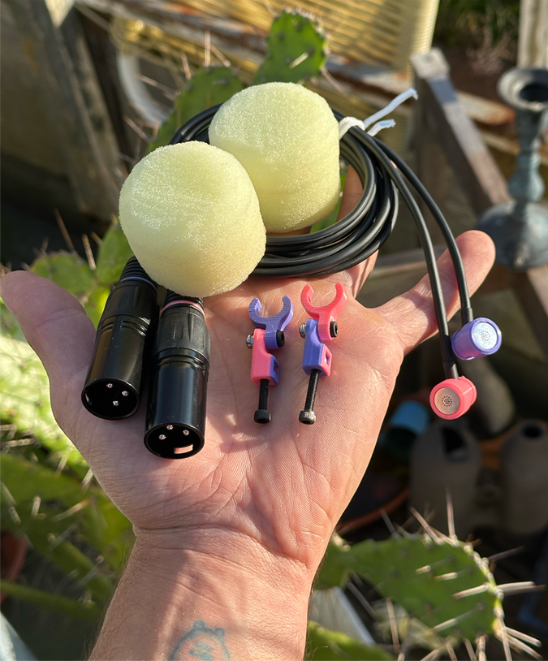

## AOM 5024 diy mics
 
second price: 90€
 
 
stereo field recording microphones with AOM 5024 capsules, extremely cheap and extremely sensitives.
 
i'm currently in love with them, and I want to share this feeling.
 
 
singularity: the capsules might lower their gain a bit when directly pointed at the sun.
 
i use tehm with the <i>bubblebee twin windbubbles black 4</i>, which shields the capsules from the sun.
 
 
they might need a boost at 10kHz–20kHz.
 
i'm making them in very small batches, so they might not be available for "fast delivery"
 
get in tocuh if you want to know more / buy 
<3 
 
 
<a href="https://drive.google.com/drive/folders/1_T2UPBCOV5OV35Ks30y2HlUz_RaEs1Y_?usp=drive_link"
 target="_blank">&#128279; google drive folder with (among other things) field recordings using the zoom f3 and them mics &#128279;</a>
 
 
 
 

